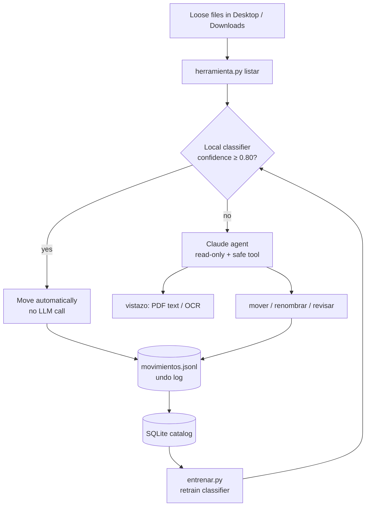

# Organizador IA

[](https://github.com/dafneayon/organizador-ia/actions/workflows/pruebas.yml)

A sandboxed AI agent that keeps my Mac's Desktop and Downloads organized. It sorts loose files into topic folders with color-coded Finder tags. A local machine learning model, trained on the agent's own past decisions, handles the easy cases without calling the LLM. Once files are organized, I can **ask questions about them**, from the terminal or from Claude Desktop through an **MCP server**, using hybrid search that runs on my Mac.

I use it every day. It has already organized 280+ of my own files: theses, papers, CFDI invoices, datasets, screenshots and more.

> Documentation in Spanish: [LEEME.md](LEEME.md). The code and the agent's instructions are in Spanish, my working language.

## Why this project

I wanted something that solves a real problem in my day-to-day life and also shows how to take AI to production safely:

- **Safety first.** An LLM with access to your files is risky, so the agent gets least-privilege tools and every action can be undone.
- **Use the right tool for each job.** A clever LLM isn't needed for a screenshot. A small classifier decides when it is confident, and the LLM handles the rest.
- **Measure everything.** Model choice, confidence threshold and precision are validated statistically, not guessed.

## How it works



1. **Agent.** It runs Claude Code headless (`claude -p`) with only `Read`, `Glob` and a `Bash` permission restricted to one script, `herramienta.py`. It has no `Write`, `Edit`, `rm`, `mv`, web access or MCP servers, and its session is not persisted.
2. **Safe tool (`herramienta.py`).** It is the only way the agent can touch the filesystem. It can list, peek, move without overwriting, rename folders (never files) and add Finder tags. It has no delete command. Anything that looks redundant goes to a "To review" folder for me to decide.
3. **Undo.** Every move, rename and path rewrite is logged, and `organizador deshacer` reverts a whole run. When a code project is moved, its absolute paths are rewritten, including `.venv` and `.git/config`, and a backup is kept first.
4. **Local classifier.** It is trained on the agent's decision history. Easy cases are moved before the agent runs, and if nothing is left, Claude isn't called at all.

## Results

### Local classifier

The classifier was trained on **240 decisions** made by the agent, across 15 classes (category + subfolder). Its only inputs are filename, extension, size and origin, never file contents.

| Model (grouped 5-fold CV × 3 repeats) | Accuracy | Macro F1 |
|---|---|---|
| Majority class (baseline) | 0.165 | 0.030 |
| Extension only + logistic regression | 0.456 | 0.359 |
| Complement Naive Bayes | 0.685 | 0.545 |
| Random forest | 0.706 | 0.539 |
| Linear SVM | 0.749 | 0.612 |
| **Logistic regression, C=0.3, balanced (selected)** | **0.743** | **0.622** |

- **Top-level category accuracy: 88%.**
- **Routing:** with a confidence threshold of **0.80**, chosen out-of-sample, the model decides **19% of files on its own at 95.7% precision** (Wilson 95% CI: 85–99%). Everything else still goes to the LLM.
- **No leakage:** cross-validation is *grouped*, so copies and versions of the same file (`cv.pdf`, `cv (1).pdf`, `cv_v2.pdf`) never end up split between train and test.
- **No self-training:** files moved by the classifier are excluded from retraining, so it never learns from its own mistakes.
- **No sklearn at runtime:** the model is exported to JSON and served with the Python standard library. Training asserts that the exported predictions match scikit-learn's.

The numbers come from a small personal dataset, so the confidence intervals are wide. They should tighten as the history grows.

### Document search (RAG)

Evaluated on a synthetic corpus of 18 documents in Spanish and English (bills, CFDI invoices, IDs, thesis chapters, papers, contracts) with 30 questions of known answer ([`evals/`](evals/)):

| Retrieval mode | Recall@1 | Recall@3 | MRR |
|---|---|---|---|
| Keywords (SQLite FTS5 / BM25) | 70% | 77% | 0.733 |
| Meaning (multilingual embeddings) | 73% | 93% | 0.824 |
| **Hybrid (Reciprocal Rank Fusion)** | **90%** | **97%** | **0.942** |

| Recall@1 by question type | Keywords | Embeddings | Hybrid |
|---|---|---|---|
| Shares words with the document (n=12) | 100% | 58% | 92% |
| Paraphrased, different words (n=12) | 75% | 75% | 92% |
| English question, Spanish document (n=6) | 0% | 100% | 83% |

Copies of the same file (`cv.pdf`, `cv (1).pdf`) are merged into one result so they don't crowd out other documents. Each method covers the other's blind spot: keywords are exact but miss paraphrases and other languages, while embeddings understand meaning but blur exact terms. The fusion beats both. Failure cases are listed in [`evals/resultados_busqueda.md`](evals/resultados_busqueda.md) and were left untuned, so the system isn't overfit to a 30-question set.

## Features

| Area | What it does | Tech |
|---|---|---|
| Agent | Classifies and organizes files with least-privilege tools, dry-run mode and monthly scheduling | Claude Code (headless), zsh, `launchd` |
| Documents | Reads PDF text, with on-device OCR (Spanish + English) for scanned pages | Swift, PDFKit, Vision |
| Data | Turns the action log into a queryable catalog with analytical views | SQLite, SQL (CTEs, window functions) |
| ML | Classifier with model selection, grouped CV, threshold tuning and calibration (ECE) | scikit-learn, NumPy |
| Routing | High-confidence files are moved locally and the rest go to the LLM | Pure-Python inference |
| Search | Incremental index of PDFs (with OCR), Office files, LaTeX and CFDI XML; hybrid retrieval; answers with citations | SQLite FTS5, fastembed (ONNX), NumPy, RRF |
| MCP | Read-only tools so Claude Desktop / Claude Code can search and read my documents | Model Context Protocol (JSON-RPC over stdio, implemented from scratch) |
| Evals | Retrieval benchmark with Recall@k and MRR per question type | Synthetic labeled corpus |
| Quality | 56 tests in a sandboxed fake `$HOME`, so real files are never touched; CI on macOS | unittest, GitHub Actions |
| Privacy | Personal data (logs, model, catalog, backups) never leaves the machine or the repo | `.gitignore`, env flags |

## Usage

```bash
~/OrganizadorIA/organizador simulacro          # dry run: show what it would do
~/OrganizadorIA/organizador ahora              # organize Desktop and Downloads now
~/OrganizadorIA/organizador ahora ~/Documents/Uni   # organize one folder in place
~/OrganizadorIA/organizador programar 8 10:00  # every month on day 8 at 10:00
~/OrganizadorIA/organizador deshacer           # undo the last run
~/OrganizadorIA/organizador entrenar           # rebuild catalog and retrain classifier
~/OrganizadorIA/organizador indexar            # index document text (incremental)
~/OrganizadorIA/organizador buscar "electricity bill"
~/OrganizadorIA/organizador preguntar "¿cuándo vence mi pasaporte?"   # cited answer from Claude
~/OrganizadorIA/organizador mcp-config         # how to connect the MCP server
```

Settings live in [`config.json`](config.json): categories and colors, which folders to organize, project protection and classifier options (`usar`, `auto_mover`, `precision_objetivo`).

Optional dependencies. The organizer and keyword search need none:

```bash
/usr/bin/python3 -m venv .venv
.venv/bin/pip install -r requirements-entrenamiento.txt   # train the classifier
.venv/bin/pip install -r requirements-busqueda.txt        # semantic search (embeddings)
```

**Privacy:** indexing, embeddings and search run locally. Only `preguntar` sends the retrieved snippets to Claude, and Claude gets no tools. Keys and certificates (`.key`, `.cer`, `.pem`, including Mexico's SAT e.firma) are never read or indexed.

Run the tests:

```bash
/usr/bin/python3 -m unittest discover -s tests -v
```

## Project structure

```
organizador            CLI: run, dry-run, schedule, undo, train
instrucciones.md       Agent system prompt (rules and procedure)
herramienta.py         The only tool the agent can use (safe file operations)
extraer.py             Text extraction: PDF, Office, CFDI XML, plain text
pdf_texto.swift        PDF text extraction + OCR (compiled on first use)
rasgos.py              Feature extraction + dependency-free inference
catalogo.py            Action log → SQLite catalog
consultas.sql          Example analytical queries
entrenar.py            Model comparison, threshold selection, export
busqueda.py            Document index + hybrid search + RAG answers
mcp_servidor.py        MCP server (stdio) for Claude Desktop / Claude Code
evals/                 Synthetic corpus, labeled questions, retrieval benchmark
tests/                 Safety, classifier, search and MCP tests
.github/workflows/     CI on macOS
```

## Roadmap

- [x] **Phase 1, Foundations:** safety test suite, CI, on-device PDF reading and OCR
- [x] **Phase 2, Learns from me:** SQLite catalog, local classifier, ML + LLM routing
- [x] **Phase 3a, Answers questions:** hybrid search over my documents (RAG with local embeddings), an **MCP server** for Claude Desktop, retrieval evals
- [ ] **Phase 3b, Reminds me:** extraction of expiration dates (ID, passport, contracts, insurance) and invoice amounts with structured outputs, plus reminders
- [ ] **Phase 4, Product:** FastAPI service with a review screen for the "To review" folder (human-in-the-loop feedback for retraining), OpenTelemetry tracing (tokens, cost, latency), a dashboard and Docker for the API and search services

## Author

**Dafne Gissell Ayon Rosales**, AI/ML Engineer · M.Sc. in Bioengineering and Intelligent Computing  
[LinkedIn](https://linkedin.com/in/dafneayon) · [GitHub](https://github.com/dafneayon)
